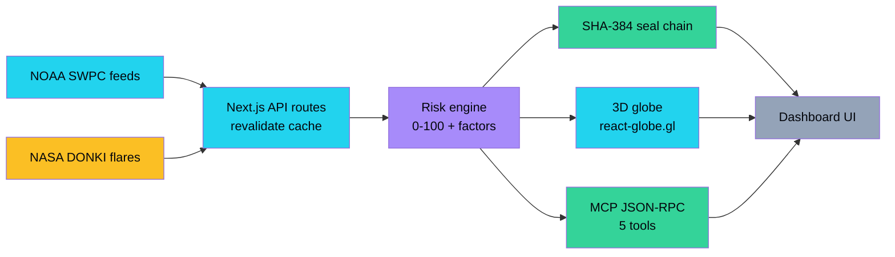
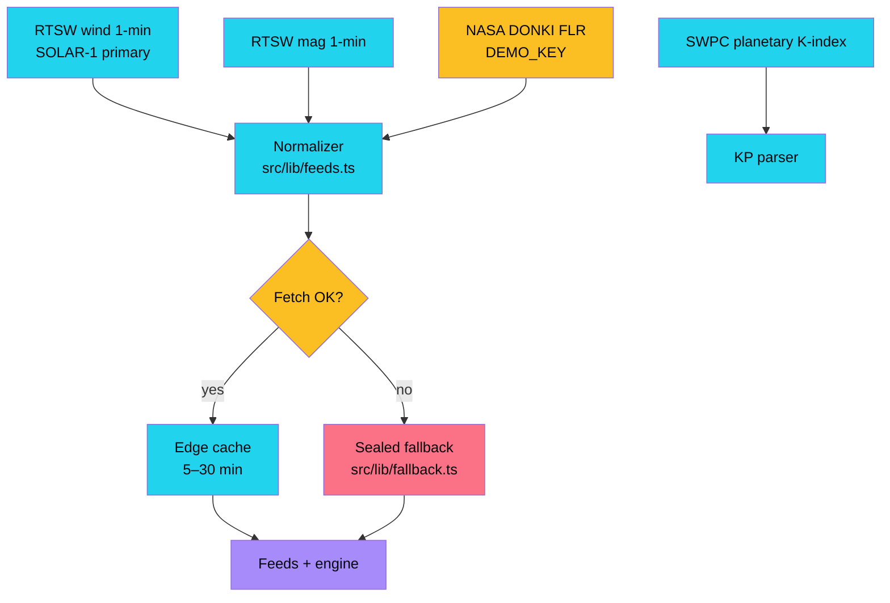
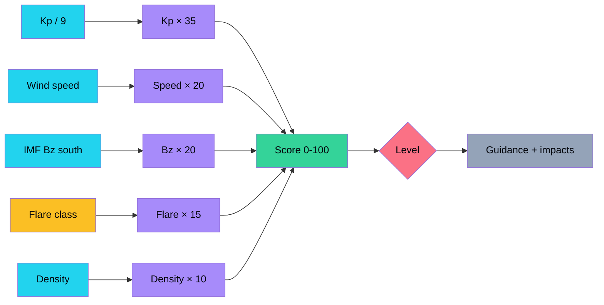
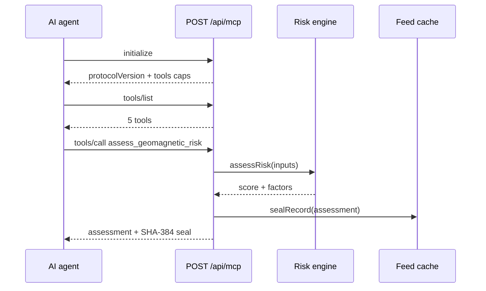
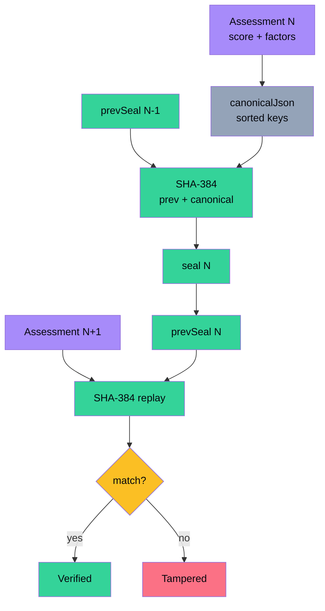
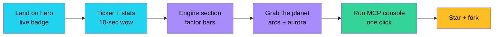
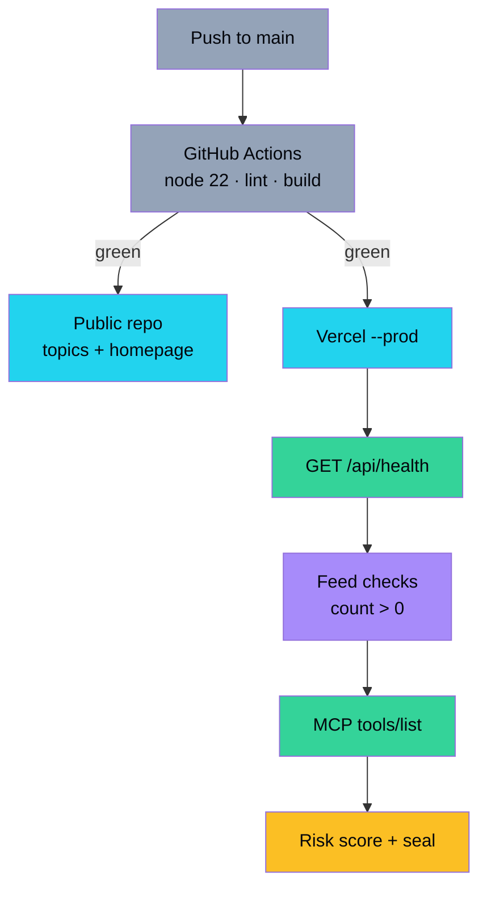
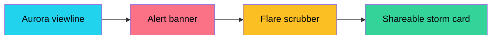
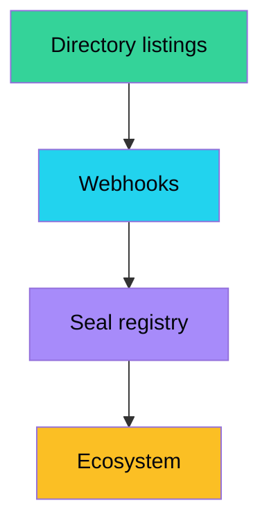
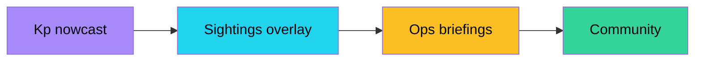

<div align="center">

# ☀️ Solar Sentinel

**Watch solar storms hit Earth live — risk engine, 3D planet, agent tools, verifiable seals.**

[](https://solar-sentinel-vert.vercel.app)
[](./LICENSE)
[](https://nextjs.org/)
[](https://www.swpc.noaa.gov/)
[](./public/mcp.json)
[](./.github/workflows/ci.yml)

[Live App](https://solar-sentinel-vert.vercel.app) · [API](https://solar-sentinel-vert.vercel.app/api/health) · [MCP](https://solar-sentinel-vert.vercel.app/api/mcp) · [Issues](https://github.com/aniruddhaadak80/solar-sentinel/issues)

</div>

> Solar-max 2025–2026 is firing X-flares at Earth right now. Solar Sentinel streams
> **NOAA solar-wind + Kp** and **NASA DONKI flares** into one deterministic risk score,
> paints it on a rotating 3D planet, seals every record with a hash chain,
> and hands the whole thing to coding agents as **MCP tools** — no API keys, offline-safe.

## ✨ Features

- 🛰️ **3 live feeds, zero keys** — NOAA plasma/mag, NOAA planetary K-index, NASA DONKI flares (cached API routes + sealed fallbacks)
- 🧮 **Deterministic risk engine** — 0–100 score with itemized factors; the *same function* powers UI, REST and MCP
- 🌍 **Library-grade 3D globe** — `react-globe.gl` aurora ovals, storm arcs, pulse rings driven by live Kp
- 🤖 **MCP agent interface** — JSON-RPC `initialize` / `tools/list` / `tools/call` + one-click in-page console
- ⛓️ **Hash-chained seals** — `SHA-384(prevSeal ‖ canonicalJson)` on every assessment, verifiable by replay
- 🎨 **Dark-first design system** — glass panels, ticker, stats row, `01–05` narrative, custom scrollbar

### System architecture



## 📡 Live data pipeline

Two NOAA streams plus NASA flares, normalized to typed records, cached at the edge, never breaking offline.



## 🧮 Engine flow

Weights sum to 100 — Kp 35, wind speed 20, Bz southward 20, flare 15, density 10.



## 🤖 Agent (MCP) sequence



## ⛓️ Integrity / seal chain



## 🚀 Quickstart

```bash
git clone https://github.com/aniruddhaadak80/solar-sentinel.git
cd solar-sentinel
npm ci
npm run dev
```

Zero env vars. Open http://localhost:3000 — if NOAA/NASA are unreachable you get sealed samples, clearly badged.

## 🔌 API

```bash
curl https://solar-sentinel-vert.vercel.app/api/health
curl https://solar-sentinel-vert.vercel.app/api/kp
curl https://solar-sentinel-vert.vercel.app/api/solar-wind
curl https://solar-sentinel-vert.vercel.app/api/flares
curl https://solar-sentinel-vert.vercel.app/api/risk
curl -X POST https://solar-sentinel-vert.vercel.app/api/risk \
  -H 'Content-Type: application/json' \
  -d '{"kp":6.2,"solarWindSpeed":610,"density":12,"bzGsm":-11,"maxFlareClass":"M4.2"}'
curl -X POST https://solar-sentinel-vert.vercel.app/api/mcp \
  -H 'Content-Type: application/json' \
  -d '{"jsonrpc":"2.0","id":1,"method":"tools/list"}'
```

### Agent setup (`mcp.json`)

```json
{
  "mcpServers": {
    "solar-sentinel": { "url": "https://solar-sentinel-vert.vercel.app/api/mcp" }
  }
}
```

Tools: `get_kp_index` · `get_solar_wind` · `get_flares` · `assess_geomagnetic_risk` · `verify_seal_chain`.
Full copy-paste manifest lives in [`public/mcp.json`](./public/mcp.json).

## 🧭 User journey



## 🏭 Deployment pipeline



## 📁 Project map

```text
src/
  app/
    page.tsx              # 01–05 narrative (server, cached 5 min)
    layout.tsx            # full SEO / OG / Twitter metadata
    api/
      health/route.ts     # liveness
      solar-wind/route.ts # NOAA plasma+mag (revalidate 5 min)
      kp/route.ts         # NOAA K-index (revalidate 5 min)
      flares/route.ts     # NASA DONKI (revalidate 30 min)
      risk/route.ts       # GET live sealed score · POST custom inputs
      mcp/route.ts        # JSON-RPC initialize / tools/list / tools/call
  lib/
    types.ts engine.ts feeds.ts seal.ts fallback.ts
  components/
    GlobeLoader.tsx       # client wrapper (next/dynamic ssr:false lives here)
    GlobeView.tsx         # react-globe.gl + 2D fallback only on load failure
    McpConsole.tsx Ticker.tsx Reveal.tsx
public/mcp.json           # agent manifest
```

## 🗺️ Roadmap

### Now — deepen the live picture

- [ ] Aurora-viewline map layer so users see *where* aurora is visible tonight — wow: personal "go outside" moment
- [ ] G-scale alert banner pinned to hero when Kp ≥ 5 — wow: the site reacts to the Sun
- [ ] Flare-class timeline scrubber — wow: replay the last 14 days of the Sun



### Next — agent ecosystem

- [ ] Submit to MCP directories (Glama, Smithery) — wow: installs from agent app stores
- [ ] Webhook subscriptions for G1+ onsets — wow: agents wake up when storms start
- [ ] Signed seal registry endpoint — wow: third parties verify scores without trusting us



### Later — prediction + community

- [ ] 30-min Kp nowcast from solar-wind lead time — wow: forecast, not just observation
- [ ] Crowd aurora sightings vs model overlay — wow: humans close the loop
- [ ] Multi-language briefings for grid operators — wow: real-world ops use



## ⚠️ Safety disclaimer

Space weather can affect power grids, aviation, GPS and communications.
This project is **informational and educational** — it is not an official alert source
and must not drive safety-critical decisions. Always confirm with
[NOAA SWPC](https://www.swpc.noaa.gov/) during active storms.

## 🤝 Contributing

See [CONTRIBUTING.md](./CONTRIBUTING.md) — zero-env quickstart, engine rules, PR hygiene.
Security reports: [SECURITY.md](./SECURITY.md). License: **MIT** ([LICENSE](./LICENSE)).

### Attribution

- Solar wind & K-index: [NOAA Space Weather Prediction Center](https://www.swpc.noaa.gov/)
- Flares: [NASA DONKI](https://api.nasa.gov/) via `DEMO_KEY`
- Globe: [react-globe.gl](https://github.com/vasturiano/react-globe.gl) · 3D: [three.js](https://threejs.org/)
